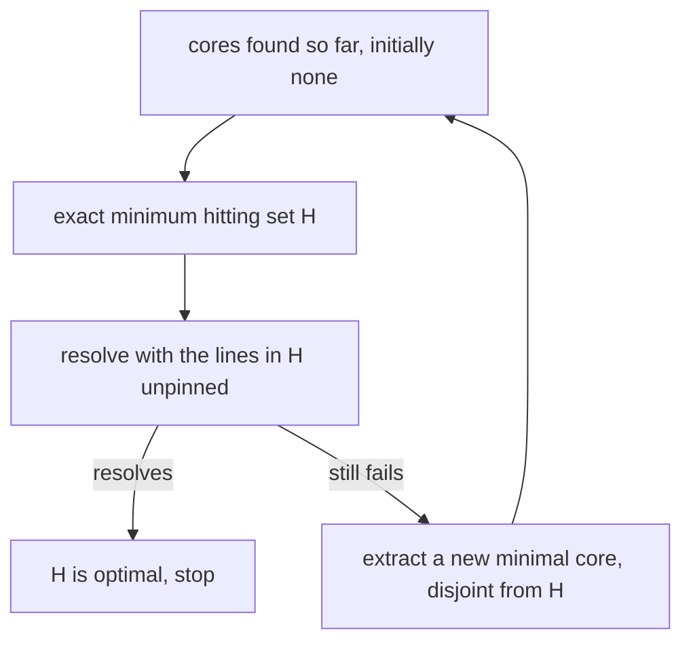
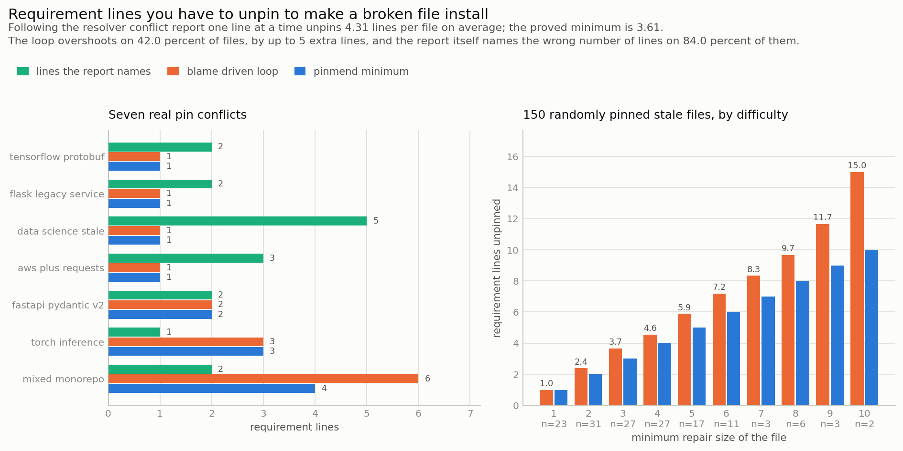
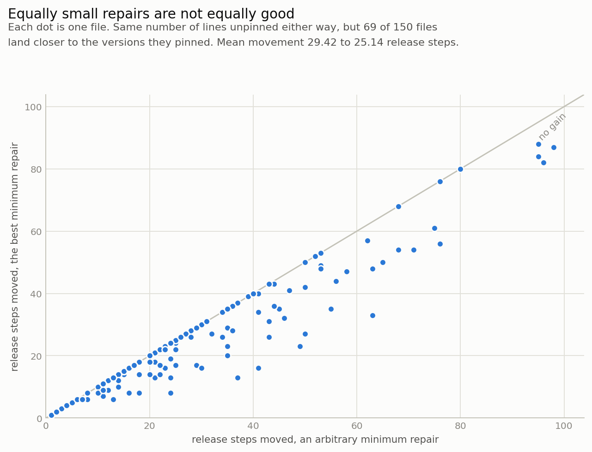

# pinmend

When a requirements file cannot be resolved, pinmend computes the provably smallest set of requirement lines you have to unpin, and proves that no smaller set exists.

## The problem

`pip install -r requirements.txt` ends at `ResolutionImpossible` and prints a conflict trace: the chain of requirements along the one path the resolver happened to take when it gave up. That trace is a diagnosis, not a repair. It tells you where the resolver gave up, not what to change. pip, Poetry and uv all differ in how readable the explanation is, and none of them computes a minimum repair.

So the workflow is a hand loop. Unpin a line the message named, run the install again (network, metadata downloads, tens of seconds), read a different message, unpin another line, repeat until it installs. You stop at the first thing that works, which is usually not the smallest thing that works, and every line you unpinned is a package that can now move without you noticing.

Measured on 150 stale requirements files built from real published metadata:

- Unpinning exactly what the conflict report names produces an installable file **16 percent** of the time.
- The report names the wrong number of lines on **84 percent** of files: it understates on 65.3 percent and overstates on 18.7 percent. The understating direction is the dangerous one, because the obvious fix then looks complete and is not.
- The hand loop, given the better of its two natural tie-breaks, unpins more lines than necessary on **42 percent** of files, by up to **5 extra lines**.

## What it does

pinmend treats the package index as hard constraints and each line of your requirements file as a soft constraint, then answers the question the resolver does not:

- **The minimum repair.** The fewest requirement lines whose relaxation makes the file install, proved minimal rather than merely small.
- **Every independent conflict.** Each minimal unsatisfiable core is reported as a set of lines, any one of which must be relaxed. Four disjoint cores means four lines, and no fewer, no matter which ones you pick.
- **A tie-break that matters.** Among repairs of the same minimum size, the one whose resulting plan sits closest to the versions you originally pinned.
- **The trade-off curve.** What unpinning one more line past the minimum actually buys you.

Relaxing a line means **unpinning** it, not deleting it. The package stays in the plan, it is just free to take another version. That also keeps unsatisfiability monotone in the set of enabled lines, which is what the optimality proof below depends on.

## Why this is worth building

The underlying problem is minimum correction subset extraction, and it has an exact method that the Python packaging ecosystem has never been handed.

A set of lines is a repair exactly when it intersects every minimal unsatisfiable subset (MUS) of the file. So the minimum repair is the minimum hitting set over all MUSes. Enumerating all MUSes is hopeless, but you do not need to. The implicit hitting set loop alternates between an exact hitting set over the cores found so far and a single resolver call:



**Why the answer is optimal.** Let `H` be the set returned and `G` be any repair at all. `G` must hit every MUS, so in particular it hits every core collected, so `G` is at least as large as the minimum hitting set of those cores, which is exactly the size of `H`. And `H` was satisfiability-checked before being returned, so it really is a repair. Therefore `H` is of minimum cardinality, proved without ever enumerating the full set of MUSes. On the benchmark this takes 28.9 resolver calls per file on average.

This matters because the alternative is a heuristic that is usually right, and "usually right" is exactly the thing you cannot tell apart from "right" without the exact answer to compare against. That is what the 42 percent figure above is measuring.

Two implementation details are load-bearing rather than incidental:

- **Cores are validated, not trusted.** The solver tracks which requirement lines caused each derived constraint, which gives a cheap candidate core on failure. That candidate is a heuristic, so it is satisfiability-checked before use and discarded if it does not reproduce the failure. A deletion pass then makes the core genuinely minimal regardless of where it started.
- **Backjumping is cross-checked.** The search abandons subtrees whose decisions cannot affect the current conflict. A wrong blame set there would silently turn an unsatisfiable file into a satisfiable one, so 120 randomized tests compare the pruned search against the plain one verdict for verdict, and 90 more compare the claimed minimum against brute force over all subsets.

## Architecture

FigJam board: https://www.figma.com/board/CPwkICBeGoJ5iqAklg9WZs

The diagram shows the loop between the resolver and the hitting set solver: the resolver turns a failure into a minimal core, the hitting set solver turns the accumulated cores into the next candidate repair, and the loop exits the first time a candidate resolves.

| Module | Responsibility |
| --- | --- |
| `pinmend/index.py` | Snapshot loading, marker evaluation for one target environment, candidate bitmask cache |
| `pinmend/solver.py` | Backtracking version solver, cause tracking, conflict directed backjumping |
| `pinmend/repair.py` | Implicit hitting set loop, deletion based core extraction, tie-break, trade-off curve |
| `pinmend/hitting.py` | Exact minimum hitting set by branch and bound, complete enumeration at the minimum |
| `pinmend/baselines.py` | The conflict report, trusting the report, and the blame driven hand loop |
| `tools/fetch_index.py` | Builds the committed metadata snapshot in `pinmend/data/` from the PyPI JSON API |

## Results



The metric is **requirement lines you have to unpin to make a broken file install**. Lower is better, because every line you unpin is a package whose version is no longer controlled.

The baseline is the loop the current tools leave you with: resolve, read the conflict report, unpin one of the lines it names, resolve again, repeat until it installs. It is given the better of its two natural tie-breaks (unpin the first named line, or the last), so the comparison is against the luckier of the two arbitrary choices rather than the unluckier one. Both sides run against the same index and the same solver, so the only difference is the method.

On 150 randomly generated stale requirements files averaging 20.4 lines each, built by pinning real packages at real published versions and keeping the ones that do not resolve:

| | blame driven loop | pinmend minimum |
| --- | --- | --- |
| Mean lines unpinned per file | 4.31 | **3.61** |
| Total lines unpinned, 150 files | 646 | **541** |
| Files where the result is larger than necessary | 63 of 150 (42.0 percent) | 0, by construction |
| Mean excess on those files | 1.67 lines, up to 5 | 0 |
| Edit and re-resolve rounds you perform | 4.31 per file | 1 |

The left panel shows the seven hand-written example files. On five of them the loop lands on the optimum, which is the honest result: when a file has one tangled spot, following the report works. The gap opens on `mixed monorepo`, a file with four independent conflicts, where the loop unpins 6 lines and 4 is provably enough. The right panel shows that this is the general shape: the harder the file, the worse the overshoot, reaching 15.0 lines against a minimum of 10 on the hardest bucket.

A note on the round count: pinmend is not cheaper in resolver calls, it makes 28.9 of them per file on average. They are just all inside one invocation against a cached index, instead of being four round trips through a network install that you drive by hand.

The green series is the third finding, and the least expected one: the number of lines the conflict report names has no sound relationship to the number you must change. On `data science stale` it names 5 lines when 1 suffices; on `torch inference` it names 1 when 3 are required. Across the suite it understates 65.3 percent of the time and overstates 18.7 percent of the time.

### Equally small repairs are not equally good



Minimum cardinality alone has a blind spot: two repairs can unpin the same number of lines and leave your dependency versions in very different places. Each dot is one file in the suite, comparing release steps moved (how far each pinned package ends up from the version you asked for) between an arbitrary minimum repair and the exact best one. The tie-break is free, since the candidates are already enumerated to prove minimality, and it helps on 69 of 150 files, cutting mean movement from 29.42 to 25.14 release steps. On the `mixed monorepo` example it is the difference between 11 release steps and 6, and on `fastapi pydantic v2` between 11 and 6 again, from a two-line repair either way.

### Honest limits

- The index is a committed snapshot of **80 projects and 2264 releases**, not all of PyPI. Dependencies on the 92 package names outside the snapshot are ignored rather than guessed at, and that is a real simplification: a conflict living entirely in an unmodelled package will not be found.
- Markers are evaluated for one fixed environment (CPython 3.10.13, Linux, x86_64), so the numbers are reproducible on any machine but describe that environment only.
- The resolver carries a node budget. 18 of the 182 generated candidate files hit it and were skipped rather than allowed to dominate the run; the count is reported in `docs/results.json` so the suite cannot quietly become easier.
- Minimum **cardinality** is proved. Release movement is measured from the plan the solver produces under its preference ordering, and the tie-break is exact over the enumerated minimum-size repairs, which is a weaker claim than global optimality in movement.
- When unpinning every line still leaves nothing installable, pinmend says so instead of looping. That case needs a line deleted, not relaxed, and the tool does not decide that for you.

## How to run it

```bash
git clone https://github.com/joelvarun/pinmend
cd pinmend
python -m pip install -r requirements.txt
```

Run the demo over all seven example files. No network is needed: the metadata snapshot is committed.

```bash
python examples/demo.py
```

```
file                     lines  report trusted    loop minimum  cores
---------------------------------------------------------------------
aws-plus-requests            6       3   works       1       1      2
data-science-stale           6       5   works       1       1      1
fastapi-pydantic-v2          6       2   works       2       2      2
flask-legacy-service         6       2   works       1       1      1
mixed-monorepo               9       2   fails       6       4      4
tensorflow-protobuf          7       2   works       1       1      1
torch-inference              7       1   fails       3       3      3
---------------------------------------------------------------------
total                                      5/7      15      13
```

Or repair one file in detail:

```bash
python -m pinmend examples/mixed-monorepo.txt --compare --pareto
```

Useful flags:

```bash
python -m pinmend examples/data-science-stale.txt            # just the minimum repair
python -m pinmend examples/torch-inference.txt --json        # machine readable
python -m pinmend examples/aws-plus-requests.txt --pareto    # size versus movement curve
python -m pinmend examples/mixed-monorepo.txt --any-minimum  # skip the movement tie-break
```

Run the test suite (445 pass, 75 skip on instances that happen to resolve, about 4 seconds). The ones that matter check the claimed minimum against brute force and the pruned search against the plain one:

```bash
python -m pytest tests -q
```

Reproduce the figures end to end. The benchmark takes about 8 minutes and writes `docs/results.json`:

```bash
python bench/run_benchmark.py
python bench/make_chart.py
```

Rebuild the metadata snapshot from PyPI (the only step that needs network, about 2.5 minutes):

```bash
python tools/fetch_index.py pinmend/data/pypi_snapshot.json.gz
```

## Example output

`examples/mixed-monorepo.txt` is one requirements file for a service that does web, AWS, numerics and linting. Nine lines, all pinned at versions that were each individually reasonable at some point.

```
$ python -m pinmend examples/mixed-monorepo.txt --compare
9 requirement lines, no satisfying set of releases exists.

what a resolver reports:
    cannot satisfy click, no release matches every constraint:
        the file requested click==7.1.2
        click>=8.0.0 required via black==22.3.0
    lines named by the report: 2

minimum repair: relax 4 of 9 lines (proved minimal over 4 cores, 21 resolver calls)
    - flask==1.1.4
    - botocore==1.29.165
    - scipy==1.7.3
    - click==7.1.2
release steps moved away from the pinned versions: 6

blame driven loop for comparison: 6 lines over 6 resolve rounds
    - flask==1.1.4
    - jinja2==3.1.2
    - urllib3==2.2.1
    - numpy==1.26.4
    - black==22.3.0
    - click==7.1.2

each unsatisfiable core, any one line of which must be relaxed:
    {click==7.1.2}
    {urllib3==2.2.1, botocore==1.29.165}
    {flask==1.1.4}
    {numpy==1.26.4, scipy==1.7.3}
```

The core list is the part that the conflict report cannot give you. Four cores, pairwise disjoint, so four lines is the floor and no clever choice beats it. Two of them are singletons, which is a stronger statement than it looks: `click==7.1.2` is impossible no matter what else you change, because every release of black in the index requires `click>=8.0.0` and black has to be installed. Of the two-line cores you may relax either side, and the tie-break picks `botocore` over `urllib3` and `scipy` over `numpy`: same four lines, but the resulting plan sits 6 release steps from your pins instead of 11.

The report, meanwhile, named 2 lines. One of them, `black==22.3.0`, is in no minimum repair at all.
